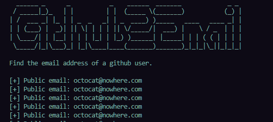

# Github2Email 📨



Github2Email is a tool to find the email of a Github User with the Official Github API.

## Features

- Simple command-line interface powered by Click.
- Search for an e-mail in all the publics repos of the user.
- Colored terminal output using Colorama.
- Lightweight and easy to use.

## Requirements

- Python 3.8+
- pip

## Installation

Clone the repository:

```bash
git clone https://github.com/vynzx/Github2Email.git
cd Github2Email
```

Install Github2Email:

```bash
pip install .
```

## Usage

Run Github2Email with a target username:

```bash
github2email octocat
```

### Help

Display the command-line help:

```bash
github2email --help
```

## Dependencies

| Library | Purpose |
|---|---|
| Click | Command-line interface |
| Requests | HTTP requests |
| Colorama | Colored terminal output |

See [THIRD-PARTY-NOTICES.md](THIRD-PARTY-NOTICES.md) for third-party license information.

## Disclaimer

Github2Email is intended for lawful purposes only.

The tool only processes publicly available information and does not bypass GitHub's privacy settings.

## How To Protect Your Email ?

When you commit something on Github, your account's email address is shared and accessible. This tool use the Official Github API to find it, but you can easily protect you from this !

Go to your Github settings and find the "Emails" sections. Go here and turn on "Keep my e-mail address private" !

It will give you a Github alias.

---

Made with Python 🐍
